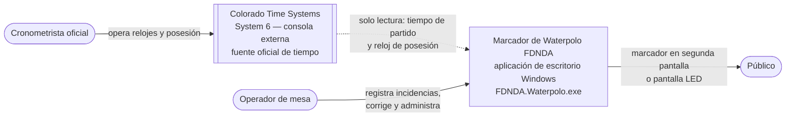
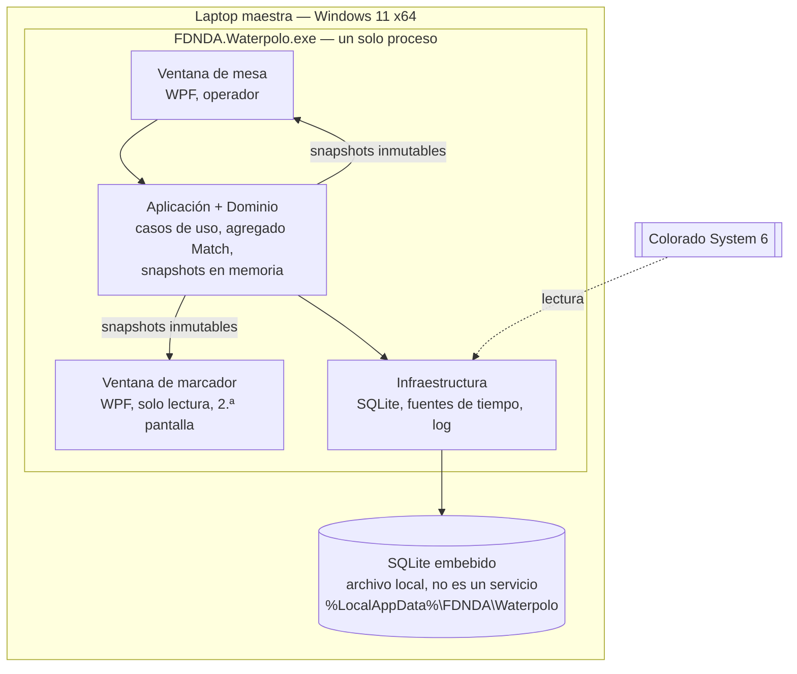
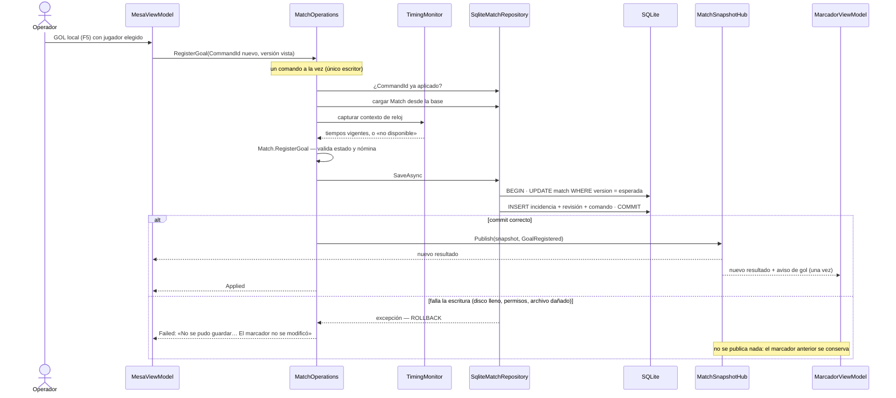
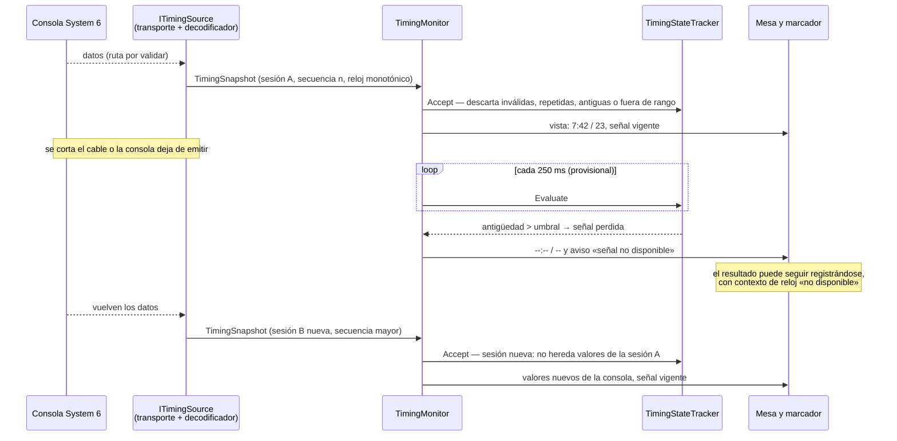

# Arquitectura — Marcador de Waterpolo FDNDA

Monolito modular de escritorio: **un proceso, un escritor de partido y una base local**. Clean
Architecture define el sentido de las dependencias; DDD táctico ligero modela el partido; MVVM
organiza las ventanas; puertos y adaptadores aíslan el cronometraje y el almacenamiento.

No hay API HTTP, servidor de base de datos, contenedores, microservicios ni mensajería.

## 1. C4 — Contexto



El programa **nunca** controla la consola. La flecha de la consola es punteada porque la ruta de
datos aún está pendiente de validación en hardware (ver [colorado-system6.md](colorado-system6.md)).

## 2. C4 — Contenedores



Las dos ventanas son **componentes del mismo ejecutable** y comparten estado en memoria
(`MatchSnapshotHub` y `TimingMonitor`). SQLite es una biblioteca dentro del proceso que escribe un
archivo; no hay servidor.

## 3. Proyectos y dependencias

| Proyecto | Destino | Contenido |
|---|---|---|
| `FDNDA.Waterpolo.Domain` | `net10.0` | Agregado `Match`, valores (`CapNumber`, `PeriodNumber`, `RulesetSnapshot`, `ClockContext`), catálogo y estadísticas. Sin UI, SQLite, puertos COM ni archivos. |
| `FDNDA.Waterpolo.Application` | `net10.0` | Casos de uso (`MatchOperations`, `CatalogOperations`, `IdentityOperations`), lecturas (`MatchQueries`), snapshots y su publicación, puertos (`IMatchRepository`, `ITournamentRepository`, `ICatalogRepository`, `IOperatorRepository`, `ITimingSource`, `IDiagnosticLog`), vigencia de relojes (`TimingStateTracker`, `TimingMonitor`). |
| `FDNDA.Waterpolo.Infrastructure` | `net10.0` | SQLite (migraciones, repositorios concretos, respaldo), datos demo, rutas, bloqueo de instancia, log rotado, `SimulatedTimingSource`, `ColoradoSystem6TimingSource`. |
| `FDNDA.Waterpolo.Desktop` | `net10.0-windows` | WPF: ventanas, ViewModels, servicio de pantallas y composición (`App.xaml.cs`). Ensamblado `FDNDA.Waterpolo.exe`. |
| `FDNDA.Waterpolo.Domain.Tests` | `net10.0` | Pruebas del dominio. |
| `FDNDA.Waterpolo.Infrastructure.Tests` | `net10.0` | Casos de uso sobre SQLite temporal, almacenamiento y cronometraje con reloj controlable. Sin WPF. |
| `FDNDA.Waterpolo.Desktop.Tests` | `net10.0-windows` | ViewModels sobre SQLite temporal, sin abrir ventanas; selección, habilitación, corrección, errores y bloqueo de doble envío. |

Dependencias permitidas:

```mermaid
flowchart LR
    Desktop --> Application
    Desktop -. solo desde App.xaml.cs .-> Infrastructure
    Infrastructure --> Application
    Infrastructure --> Domain
    Application --> Domain
```

Reglas que se mantienen:

- Los ViewModels invocan casos de uso y observan snapshots inmutables. No escriben SQL, no leen
  hardware y no recalculan el marcador. El único archivo de Desktop que nombra tipos de
  Infrastructure es `App.xaml.cs`.
- Comandos y lecturas están separados (`MatchOperations` / `MatchQueries`) sin bus ni CQRS distribuido.
- Repositorios concretos y transacciones explícitas; no hay repositorio genérico.
- Los cambios de UI se despachan al hilo de WPF con el `SynchronizationContext` capturado.

## 4. Secuencia: registro de gol → commit → nuevo marcador



Reenviar el mismo `CommandId` devuelve `AlreadyApplied` sin escribir ni publicar.

## 5. Secuencia: Colorado → lectura → pérdida de señal → reconexión



No se extrapolan tiempos: solo se muestra lo último recibido mientras siga vigente. Cada reloj
conserva su propia vigencia, porque no se asume que ambos lleguen en la misma trama. En esta versión
solo existe la implementación simulada de `ITimingSource`; el adaptador real devuelve «no disponible».

## 6. Decisiones y motivos

| N.º | Decisión | Motivo |
|---|---|---|
| D01 | Cada comando **recarga** el partido desde SQLite, aplica el cambio y guarda. | La base es la única fuente de verdad; un fallo de escritura no deja estado en memoria que corregir. El volumen de un partido es mínimo. |
| D02 | El snapshot se publica **solo después del commit**. | Requisito: si falla la escritura no se reporta éxito ni cambia el tanteo. |
| D03 | Idempotencia por `CommandId` (tabla `processed_command`); el del gol es también el id de la incidencia. | Un reintento nunca suma dos veces, ni siquiera si la respuesta se perdió. |
| D04 | Concurrencia optimista con `version` y un único escritor en proceso (`SemaphoreSlim`). | Detecta escrituras sobre estado viejo; no hay otro escritor previsto. |
| D05 | El agregado acumula cambios pendientes y el repositorio los inserta; incidencias y revisiones son de solo inserción. | Evita diferencias de estado y sostiene la auditoría. La base lo refuerza con disparadores que impiden `UPDATE`/`DELETE`. |
| D06 | Imágenes dentro de SQLite (`asset`, máx. 2 MB, PNG/JPEG). | El respaldo es un único archivo coherente. |
| D07 | `journal_mode = WAL`, `synchronous = FULL`, conexiones sin pool. | Una operación confirmada sobrevive a un cierre forzado; restaurar puede hacerse con las conexiones cerradas. |
| D08 | Respaldo con la API de backup de SQLite + `integrity_check`. | No se copia un archivo activo ignorando el WAL. |
| D09 | `TimeProvider` para la hora UTC (auditoría) y el reloj monotónico (antigüedad). | Pruebas deterministas con reloj controlable. |
| D10 | `ITimingSource.StartAsync` devuelve un resultado explícito; el adaptador Colorado responde «no disponible». | No se simula éxito en el adaptador real ni se cambia a demo por cuenta propia. |
| D11 | El simulador emite también con el reloj detenido y deja de emitir al «perder señal». | Permite distinguir pausa de pérdida. Con la consola real esto debe validarse; si solo emite al cambiar, el criterio de pérdida cambia. |
| D12 | Composición manual en `App.xaml.cs`, sin contenedor de dependencias. | Pocas piezas; menos paquetes que distribuir y licenciar. |
| D13 | Bloqueo de instancia con un archivo abierto en exclusiva dentro de la carpeta de datos. | Protege «los mismos datos», no el ejecutable; el sistema lo libera aunque el proceso muera. |
| D14 | Pantallas con Win32 (`EnumDisplayMonitors`, `SetWindowPos`) y manifiesto PerMonitorV2. | Evita depender de Windows Forms y da nitidez con escalas distintas por pantalla. |
| D15 | Las letras de acceso exigen Alt. | Hallazgo de la prueba en pantalla: WPF las dispara sin Alt y una pulsación cambió el periodo. |
| D16 | Demo y producción en carpetas y bases distintas; los datos demo solo se siembran en el perfil demo. | Los datos de demostración no pueden mezclarse con los reales. |
| D17 | `RegisterIncident` y `CorrectIncident` generalizan la ruta existente; los comandos de gol se conservan. | Un solo flujo validar → dominio → commit → publicar, con idempotencia y versión esperada para todos los tipos. |
| D18 | Resultado del penal y exclusión/expulsión pertenecen a cada revisión. | Se corrigen sin alterar el original; `CountsAsGoal` comparte el criterio de resultado y goleadores, sin crear un gol adicional por penal. |
| D19 | El tipo y el contexto original no se corrigen; se anula y se registra de nuevo si se eligió un tipo equivocado. | Mantiene explícito el registro y no atribuye una hora de juego retrospectiva. No se automatizan sanciones ni límites de tiempos muertos. |

| D20 | Casos de uso del catálogo en `CatalogOperations` (puerto `ICatalogRepository`); la programación de partidos vive en `MatchOperations.ScheduleMatchAsync`. | Todo cambio de partido pasa por el único escritor de partidos; el catálogo no toca partidos. |
| D21 | Las altas del catálogo usan `INSERT … ON CONFLICT (id) DO NOTHING` y la programación registra su id en `processed_command`. | Idempotencia sin tabla nueva: un doble envío o reintento devuelve «ya aplicado». |
| D22 | En la interfaz, el catálogo es un `CatalogViewModel` aparte que la mesa recibe por la propiedad `Catalog`. | No cambia el constructor de `MesaViewModel` y aísla la pestaña; al programar, la mesa recarga su lista sin abrir el partido. |
| D23 | Importación de nóminas en tres pasos: `IRosterFileReader` (Infrastructure) lee el archivo como tabla de textos; `RosterImportPlanner` (Application, puro) valida, compara con la nómina actual y aplica las decisiones; `ICatalogRepository.ApplyRosterImportAsync` escribe en una transacción. | El planificador se prueba sin archivos ni base; la vista previa no escribe nada; el ViewModel solo muestra y recoge decisiones. |
| D24 | La vista previa guarda la nómina que usó; al confirmar, el repositorio la compara dentro de la transacción y aborta si cambió. La nómina del equipo se reescribe entera (borrar e insertar) en esa transacción. | Concurrencia optimista sin versión nueva en el esquema; un intercambio de gorros no choca con `UNIQUE (evento, equipo, gorro)` a mitad de camino. Las inscripciones de evento no tienen referencias entrantes. |
| D25 | XLSX con lector propio (`System.IO.Compression` + `XmlReader`, DTD prohibida, partes limitadas en tamaño) en lugar de ClosedXML o ExcelDataReader. | Ninguna dependencia ni licencia nueva; solo se necesita leer una hoja de cuatro columnas. No evalúa fórmulas: toma el último valor guardado. |
| D27 | `ConnectionStatusViewModel` (Desktop) reúne lo que ya observan `ITimingFeed`, `IScoreboardHost` (ahora con `Placement`) y un `IStorageProbe`; no abre conexiones ni cambia la fuente. La mesa lo recibe por la propiedad `Connections`. | Un solo lugar para ver contingencias, sin tocar dominio ni cronometraje; se prueba sin ventanas ni hardware. |
| D28 | Selector de color con `ChooseColor` de `comdlg32` (P/Invoke), no Windows Forms. | Igual que D14: sin dependencia de Windows Forms. |
| D26 | Los diálogos de la pestaña (`ICatalogDialogs`: elegir archivo, vista previa, editor de reglas, confirmar, color) se inyectan en `CatalogViewModel`. | Las pruebas de ViewModels simulan al operador sin abrir ventanas. |
| D31 | PDF con escritor propio (`Infrastructure/Export/PdfReportWriter.cs`): PDF 1.4, A4, solo texto y líneas con Helvetica y Helvetica-Bold (fuentes estándar que todo lector trae, sin incrustar) en codificación WinAnsi; anchos de carácter de las métricas AFM para alinear y cortar con «…». | Los resúmenes son tablas de texto: no justifican una librería ni verificar su licencia (QuestPDF condiciona la suya a los ingresos; PDFsharp sería la alternativa MIT si se necesitan imágenes, por ejemplo escudos en R7). Validado con PyMuPDF fuera del programa. |
| D32 | Resúmenes (R6): el dominio cuenta los totales (`MatchStatistics.Totals`); `ReportBuilder` arma `MatchReport`/`TournamentReport` desde los agregados; `ReportDocuments` los convierte en un `ReportDocument` neutral (título, líneas, tablas) y `IReportWriter` (Infrastructure: `CsvReportWriter`, `PdfReportWriter`, `ReportFileWriter`) lo vuelca. | El CSV y el PDF dicen exactamente lo mismo; los totales salen del mismo agregado que el marcador. |
| D30 | Respaldos (R5): puerto `IBackupStore` (Application) implementado por `SqliteBackupStore` (Infrastructure); `BackupOperations` aplica las reglas (partido en juego, perfil) y corre el trabajo de archivos con `Task.Run`. Restaurar = `source.BackupDatabase(live)` sobre la base en uso, migración y verificación; ante un fallo, la misma copia desde `antes-de-restaurar-….db`. La mesa recibe `BackupsViewModel` por la propiedad `Backups` y le asigna `ReloadAfterRestore`, que descarta el partido en memoria y recarga lista, partido y catálogo. | Restauración atómica sin cerrar el programa ni reemplazar archivos con el WAL abierto (cada operación abre y cierra su conexión, sin pool). La migración se inyecta para probar la vuelta atrás. Descartar el snapshot es necesario porque la mesa no acepta una versión menor del mismo partido. |
| D33 | Identidad visual (R7): el dominio valida las imágenes por su contenido (`ImageInspector`, `ImageAsset`: firma y cabecera PNG/JPEG, peso y dimensiones) y modela la plantilla (`EventBranding`, `SponsorAsset`, `TeamImages`); `IdentityOperations` (Application) usa el puerto `IIdentityRepository` (`SqliteIdentityRepository`), `IImageFileReader` (`ImageFileReader`, rechaza por tamaño antes de leer) e `IExampleIdentitySource` (`ExampleIdentitySource`, imágenes embebidas desde `samples/identidad-ejemplo`). Migración `0003_identidad.sql`. | Sin librería de imágenes en el dominio ni en Application; WPF decodifica solo para mostrar. Las imágenes siguen en la base (D06), así que el respaldo las lleva sin cambios en R5. |
| D34 | La identidad del partido abierto (`ScoreboardIdentity`) se publica por un `ScoreboardIdentityHub` aparte del de snapshots: `IdentityOperations` la relee al cambiar de partido (publicación `Loaded` o `MatchId` distinto) y después de cada cambio de identidad confirmado. El marcador y la mesa la aplican solo si su `MatchId` coincide con el partido mostrado. | El snapshot del partido sigue siendo la única fuente del resultado y no carga imágenes en cada incidencia. La identidad no se congela en el partido (presentación, no registro). |
| D35 | Avisos del marcador: `ActionBanner.For` (Desktop, puro) decide a partir de la publicación (`GoalRegistered`/`IncidentRegistered`, tipo y detalle de la incidencia) y de `ScoreboardSettings` (interruptor general y por tipo). El `MarcadorViewModel` los muestra 4 s con `TimeProvider` inyectable; la ventana los anima con opacidad en la franja inferior. | Una sola regla, probada sin ventanas, para «una vez por acción nueva»: correcciones, anulaciones, cambios de etapa y la apertura del marcador nunca coinciden con un registro nuevo. |
| D37 | Tanda (R8): la etapa `MatchStage.Shootout` y el lanzamiento como incidencia `IncidentType.ShootoutAttempt` (con `PenaltyResult`) dentro del mismo agregado `Match`. `Match.Score` no cuenta lanzamientos; `Match.ShootoutScore` los cuenta aparte; `Match.ShootoutBlocker` dice por qué no se puede iniciar y el snapshot lo lleva para que la mesa habilite el botón sin recalcular reglas. La prórroga son periodos posteriores a `PeriodCount` (`RulesetSnapshot.OvertimePeriodCount`), sin etapa propia. | Reutiliza revisiones, idempotencia, auditoría, persistencia y respaldo sin un segundo modelo. Separar la tanda en otra tabla habría duplicado corrección y anulación. |
| D38 | Migración 0004 reconstruye `match`, `match_incident` y `match_status_change` (procedimiento oficial de SQLite para cambiar un `CHECK`). `MigrationRunner` reconoce la marca `-- @desactivar-claves-foraneas`: desactiva las claves foráneas fuera de la transacción y exige `foreign_key_check` vacío antes de confirmar. | Los `CHECK` de 0001 no admitían los valores nuevos y no se editan migraciones publicadas. La verificación evita confirmar referencias rotas mientras las claves están apagadas; el respaldo previo a migración sigue ocurriendo. |
| D44 | Reprogramar, actualizar nómina y anular (R10) son comandos del agregado `Match` (`Reschedule`, `ReplaceRoster`, `Cancel`) que solo valen con el partido `Scheduled`, y pasan por `MatchOperations` como los demás (idempotencia, versión, auditoría en `match_status_change`). Anular es el estado `MatchStatus.Cancelled`, no un borrado. Estos comandos publican el snapshot (`MatchChangeKind.PreMatchChanged`, sin animaciones) solo si el partido es el abierto (`IMatchSnapshotPublisher.CurrentMatchId`). En la interfaz, la mesa pasa el partido elegido de la lista al `CatalogViewModel` (`ListedMatch`), que reutiliza el formulario de programación en modo reprogramación. Migración 0005. | Respeta la regla de solo inserción del historial y deja rastro de quién anuló y por qué. Publicar siempre habría cambiado el marcador del público al reprogramar otro partido. Reutilizar el formulario evita una ventana más con los mismos campos. |
| D39 | En el marcador, la tanda va dentro del panel de cada equipo (bajo su resultado, que se reduce con `Viewbox` solo si hace falta) y no usa la franja de avisos. | Se lee junto a su equipo, no tapa relojes y no se confunde con un aviso pasajero. |
| D40 | Reproducción (R9): `ReplayTimingSource` (Infrastructure) implementa `ITimingSource` y el puerto `IReplayControl` (Application: nombre, avance, *Reiniciar*, aviso `ProgressChanged`). Lee un formato normalizado propio con `TimingRecordingParser` y entrega cada muestra con la marca monotónica de su instante programado. `App.xaml.cs` la elige con `--reproduccion` solo en el perfil demo; la mesa recibe `IReplayControl` por la propiedad `Replay`. | Determinista y probable con un reloj controlable; el resto del programa (tracker, monitor, vigencia, contexto de reloj) no cambia. El formato normalizado separa la reproducción del protocolo de la consola, que no se conoce. |
| D41 | Preparación del hito B: `CtsScoreboardDecoder` (formato básico del flujo de tablero) y `CtsWaterPoloInterpreter` (`IColoradoFrameDecoder`, canales configurables) en Infrastructure; `CtsCapture` (captura en texto, análisis y conversión a la grabación de R9). La lectura del puerto vive **solo** en la herramienta aparte `tools/FDNDA.Waterpolo.Captura` (`System.IO.Ports`), que nunca escribe; la mesa no la referencia y `ColoradoSystem6TimingSource` sigue «no disponible». | Se puede preparar y probar el decodificador sin hardware y llevar al día de la prueba una herramienta que capture y analice, sin arriesgar que el programa de competencia use una hipótesis no validada. |
| D42 | Lectura de la consola (hito B): `CtswpFrameDecoder` (tramas `CTSWP1.1c` de COM PORT 2, observadas con la consola de la FDNDA), `SerialColoradoTransport` (System.IO.Ports, solo lectura, sin operación de envío) y `ColoradoSystem6TimingSource` en Infrastructure. `App.xaml.cs` lo crea solo con `--perfil produccion --puerto COMx`; sin puerto, «no disponible» con el motivo. Cada conexión es una sesión nueva; reintentos con espera creciente (0,5 s a 5 s). Solo se toman relojes y periodo: goles, tiempos muertos y exclusiones siguen en la mesa. | La ruta observada es un puerto serie estándar y el paquete es multiplataforma (MIT): no justifica un proyecto aparte. El transporte es delgado y se sustituye en las pruebas; decodificador y fuente se prueban sin hardware con capturas reales. La consola no guarda el partido al apagarse, así que el marcador oficial sigue siendo el de la mesa. |
| D43 | Descanso y periodo de la consola: `TimingMonitor.FollowMatch` observa el partido de la mesa (`IMatchSnapshotFeed`) y, con el partido en descanso, `TimingStateTracker` presenta el silencio de la fuente como `SignalState.Intermission` (sin alarma, sin tiempos, sin contingencia). `TimingView.SourcePeriod` lleva el periodo de la fuente solo con señal vigente; la mesa avisa si difiere del suyo y no lo cambia. | La consola no emite durante el descanso: por los datos no se distingue de un cable suelto. Decide el estado que fija el operador en la mesa, que ya es la fuente oficial del periodo; deducirlo de la consola fallaba con *Period +1* a mitad de periodo. |
| D36 | Imágenes en WPF con `ImageDataConverter` (Presentation): decodifica con `BitmapImage` a un alto máximo (`DecodePixelHeight`), congela la imagen, la cachea por `AssetId` y devuelve vacío si no puede decodificarla. Los ViewModels exponen `ImageData` (id y bytes), no tipos de WPF. | Los ViewModels se prueban sin WPF de imágenes; una imagen dañada nunca detiene el marcador; la memoria queda acotada. |
| D29 | Reglas por evento (R4): `RulesEditorViewModel` + `ReglasEventoWindow` editan; `CatalogOperations.UpdateTournamentRulesAsync` normaliza con `RulesetSnapshot.ForEvent` (el dominio decide si es el preset DEMO o «Personalizadas del evento (sin aprobación técnica)») y `ICatalogRepository.UpdateTournamentAsync` escribe nombre y reglas. Sin migración: las columnas `rules_*` existen desde 0001. | El operador no puede presentar como reglamentarias reglas no aprobadas. La copia al iniciar (`match_ruleset_snapshot`) ya garantizaba que editar el evento no toca partidos iniciados. |

## 7. Dependencias y licencias

Versiones fijas en `Directory.Packages.props`. SDK fijado en `global.json` (10.0.x).

### Distribuidas con el programa

| Componente | Versión | Licencia | Notas |
|---|---|---|---|
| .NET Runtime y Windows Desktop (WPF) | 10.0.15 | MIT | Incluido en el paquete self-contained. |
| Microsoft.Data.Sqlite (+ Core) | 10.0.15 | MIT | Proveedor ADO.NET. |
| SQLitePCLRaw (bundle_e_sqlite3, core, lib, provider) | 2.1.13 | Apache-2.0 | Dependencia transitiva; incluye `e_sqlite3.dll`. |
| SQLite | incluida en `e_sqlite3.dll` | Dominio público | |
| CommunityToolkit.Mvvm | 8.4.2 | MIT | MVVM con generadores de código. |

Ninguna requiere activación en línea. Las licencias se verificaron contra lo que declara cada
paquete; antes de la primera entrega formal se debe adjuntar el texto de cada licencia en el
instalador (fase C).

### Solo desarrollo y pruebas (no se distribuyen)

| Componente | Versión | Licencia |
|---|---|---|
| xunit | 2.9.3 | Apache-2.0 |
| xunit.runner.visualstudio | 3.1.5 | Apache-2.0 |
| Microsoft.NET.Test.Sdk | 18.12.0 | MIT |

### Solo la herramienta de captura del hito B (`tools/`, no va con la mesa ni con su instalador)

| Componente | Versión | Licencia | Notas |
|---|---|---|---|
| System.IO.Ports (+ runtime.native.System.IO.Ports) | 10.0.15 | MIT | © Microsoft; verificado en el `.nuspec` del paquete restaurado (2026-11-24). Solo se usa para **leer** el puerto serie (Infrastructure, D42, y la herramienta de captura). |

El formato de la salida de tablero se tomó de las **descripciones** de proyectos de terceros
(scorebox-consoles y coloradoScoreboard, ambos MIT; ver colorado-system6.md §6). El código del
decodificador es propio; no se copió código de esos proyectos.

### Excel y PDF

**XLSX (R3):** sin librería. La lectura de nóminas usa un lector propio sobre `System.IO.Compression`
y `System.Xml` del runtime (D25); no añade paquetes ni licencias. Si más adelante hiciera falta leer
formatos que no cubre, las candidatas siguen siendo ClosedXML o ExcelDataReader (publicadas como MIT),
verificando versión y licencia vigentes al incorporarlas.

**PDF (R6):** sin librería. Escritor propio de texto y líneas con las fuentes estándar del formato
(D31); no añade paquetes ni licencias. R7 decidió **no** poner imágenes en el PDF por ahora
(requisitos §2.2). Si se pidieran escudos o logos en el acta, la candidata es PDFsharp (publicada como MIT), verificando versión y licencia vigentes al incorporarla;
QuestPDF tiene una licencia comunitaria condicionada a los ingresos de quien la usa y requiere
revisión. Descartar licencias no comerciales o de pago por uso (por ejemplo, EPPlus desde su versión 5).

**Imágenes (R7):** sin librería. El formato y las dimensiones se leen de la cabecera PNG/JPEG en el
dominio; la decodificación para mostrar la hace WPF (`BitmapImage`), que ya forma parte del runtime.
Las imágenes de ejemplo (`samples/identidad-ejemplo`) son originales del proyecto, dibujadas con
formas y texto en Segoe UI; no reproducen marcas de terceros.
