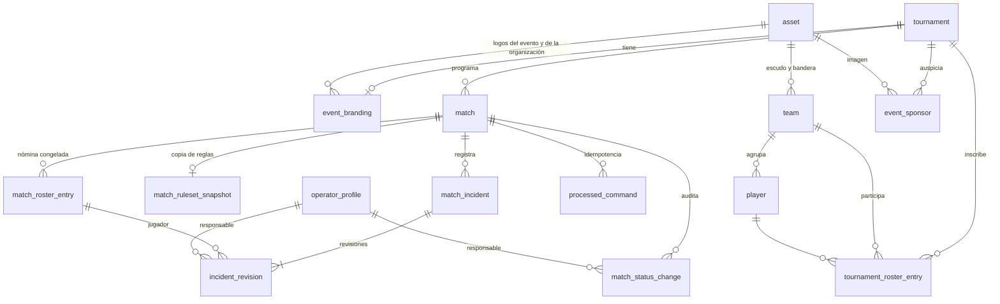

# Modelo de datos — Marcador de Waterpolo FDNDA

Esquema versión 3: `0001_inicial.sql` (sin cambios) + `0002_detalles_incidencias.sql` +
`0003_identidad.sql` (R7), en `src/FDNDA.Waterpolo.Infrastructure/Persistence/Migrations/`.

## 1. Ubicación y archivos

| Qué | Dónde |
|---|---|
| Datos de producción | `%LocalAppData%\FDNDA\Waterpolo\produccion\waterpolo.db` |
| Datos de demostración | `%LocalAppData%\FDNDA\Waterpolo\demo\waterpolo.db` |
| Respaldos | subcarpeta `respaldos\` de cada perfil |
| Registro de diagnóstico | subcarpeta `logs\` (`waterpolo.log`, rotado: 1 MB × 5) |
| Bloqueo de instancia | `instancia.lock` en la carpeta del perfil |

Los binarios viven en otra ubicación (carpeta de instalación). Actualizar el programa no toca la
carpeta de datos. La opción `--datos <carpeta>` cambia la raíz (pruebas y diagnóstico).

Convenciones: identificadores GUID en `TEXT`; fechas ISO-8601 en **UTC** (la interfaz presenta en
`es-PE`); enumerados como texto; `PRAGMA foreign_keys = ON`, `journal_mode = WAL`, `synchronous = FULL`.

**No se guardan** DNI, fecha de nacimiento, correo ni otros datos personales que el marcador no necesita.

## 2. Entidades

| Modelo | Tabla | Uso en este corte |
|---|---|---|
| `Tournament` | `tournament` | Evento con sus reglas configurables (`rules_*`, editables desde R4) y marca `is_demo`. `rules_preset_name` es el preset DEMO o «Personalizadas del evento (sin aprobación técnica)». |
| `Team` | `team` | Código único, nombre, color `#RRGGBB`, color de gorro, escudo (`crest_asset_id`) y bandera (`flag_asset_id`, desde 0003) opcionales. |
| `Player` | `player` | Solo nombre y equipo. |
| `TournamentRosterEntry` | `tournament_roster_entry` | Jugador + gorro por evento. `UNIQUE (evento, equipo, gorro)`: el mismo gorro en equipos distintos es válido. Desde R3 se edita (alta, cambio de gorro, baja) y la importación reescribe la nómina de cada equipo afectado en una transacción. Nada la referencia: los partidos copian la nómina en `match_roster_entry`. Corregir el nombre actualiza `player.full_name`; quitar una inscripción no borra al jugador. |
| `Match` | `match` | Estado, etapa, periodo, versión y **datos del equipo congelados** (código, nombre, colores, gorro) y nombre del evento. |
| `MatchRosterEntry` | `match_roster_entry` | Nómina del partido con nombre y gorro congelados. |
| `RulesetSnapshot` | `match_ruleset_snapshot` | Reglas copiadas del evento **al iniciar** el partido. |
| `MatchIncident` | `match_incident` | Tipo, secuencia por partido, periodo, contexto de reloj y hora. Solo inserción. |
| `IncidentRevision` | `incident_revision` | Revisión 1 = registro original; siguientes = corrección o anulación, con motivo, operador y hora. Solo inserción. |
| `MatchStatusChange` | `match_status_change` | Inicio, descanso, periodo, cierre, reapertura e inicio o anulación de la tanda (0004), con operador, hora y motivo. Solo inserción. |
| `OperatorProfile` | `operator_profile` | Identificación local por nombre (único sin distinguir mayúsculas). |
| `EventBranding` | `event_branding` | Plantilla del marcador por evento (R7): título, subtítulo, color de cabecera (`primary_color_hex`), color de acento (`accent_color_hex`, 0003), logo del evento y logo de la organización (`organizer_logo_asset_id`, 0003). Una fila por evento, opcional: sin ella el marcador usa el nombre del evento y colores predeterminados. Es presentación: no se copia al partido. |
| `SponsorAsset` | `event_sponsor` | Auspiciadores del evento (0003): posición 1–8, nombre e imagen. Se reescriben completos al guardar la plantilla. |
| `ImageAsset` | `asset` | Imagen PNG/JPEG validada por contenido (2 MB, 16–4096 px por lado), con tipo (`Escudo`, `Bandera`, `Auspiciador`, `LogoEvento`), nombre de archivo y SHA-256. Desde R7 se usa; las imágenes no se editan: reemplazar inserta otra y borra, en la misma transacción, las que ya nadie referencia. Viajan en el respaldo con la base. |
| — | `processed_command` | Identificadores de comandos aplicados. |
| — | `schema_migrations` | Migraciones aplicadas. |

La migración `0002` añade a `incident_revision` los campos opcionales `penalty_result`
(`Converted`/`NotConverted`, obligatorio solo para penal) y `exclusion_kind`
(`Exclusion`/`Expulsion`, obligatorio solo para exclusión). Cada revisión, incluida la anulación,
conserva sus detalles. Los goles versión 1 mantienen ambos campos nulos; no se reescriben.
Tiempo muerto lleva equipo y jugador nulo. Los demás tipos exigen jugador de su lado y partido.
Un disparador nuevo valida esos vínculos y detalles al insertar; se conservan todos los
disparadores de solo inserción de `0001`. Tipo, periodo, reloj y hora del registro son inmutables.

La migración `0003` (R7) añade `team.flag_asset_id`, `event_branding.accent_color_hex`,
`event_branding.organizer_logo_asset_id` y la tabla `event_sponsor`. Solo agrega columnas
anulables y una tabla: no reescribe datos; probada sobre una base v1 con partidos e incidencias.
Las imágenes **no** se congelan en el partido (a diferencia de nombres, colores y nómina): son
presentación y se leen del catálogo vigente al mostrarse.

La migración `0004` (R8) modela la prórroga y la tanda de penales:

- `tournament.rules_overtime_period_count` (0 por defecto = sin prórroga) y
  `rules_overtime_period_seconds` (180 por defecto, ilustrativo); las mismas columnas sin prefijo en
  `match_ruleset_snapshot`, que se copian al iniciar el partido como el resto de las reglas.
- `match.stage` admite `Shootout` (tanda). La prórroga no tiene etapa propia: son los periodos
  posteriores a `period_count`.
- `match_incident.type` admite `ShootoutAttempt` (lanzamiento de la tanda): lleva jugador de su lado
  y `penalty_result` en cada revisión, como el penal; el disparador de validación de `0002` se
  recrea con esa regla.
- `match_status_change.kind` admite `ShootoutStarted` y `ShootoutCancelled`; este último exige motivo.

SQLite no permite cambiar un `CHECK`, así que `0004` reconstruye `match`, `match_incident` y
`match_status_change` con el procedimiento oficial (tabla nueva, copia con columnas explícitas,
borrado, renombre) y recrea el índice de partido único en juego y los disparadores de solo inserción.
El script lleva la marca `-- @desactivar-claves-foraneas`: `MigrationRunner` desactiva las claves
foráneas fuera de la transacción (el `PRAGMA` no tiene efecto dentro de una) y, antes de confirmar,
exige un `PRAGMA foreign_key_check` vacío; si no, revierte. Las filas se copian tal cual: ninguna
incidencia, revisión ni cambio de estado se reescribe. Probada sobre una base v1 con un partido en juego.

La migración `0005` (R10) permite reprogramar, actualizar la nómina y anular partidos no iniciados:

- `match.status` admite `Cancelled` (anulado), solo con `stage = 'PreMatch'` y periodo 0. El partido
  anulado no se borra; `ListTournaments` no lo cuenta en `MatchCount`.
- `match_status_change.kind` admite `Rescheduled`, `RosterReplaced` y `Cancelled`; este último exige
  motivo.
- Al reprogramar se actualizan en `match` la descripción, la fecha y el color y gorro de cada equipo
  (equipos, códigos y nombres congelados no cambian).
- `match_roster_entry`: disparadores nuevos impiden modificar filas y borrarlas si el partido no está
  `Scheduled`. Actualizar la nómina borra e inserta la del partido en la misma transacción del comando.

Como `0004`, reconstruye `match` y `match_status_change` con las claves foráneas desactivadas y
`foreign_key_check` antes de confirmar. Probada sobre una base v1 con un partido en juego.

## 3. Invariantes

| Regla | Dónde se garantiza |
|---|---|
| Local y visita son equipos distintos. | Dominio (`Match`) y `CHECK` en `match`. |
| Gorro único por lado en el partido; el mismo gorro en ambos equipos es válido. | Dominio y `UNIQUE (match_id, side, cap_number)`. |
| Un solo partido en juego. | Caso de uso `StartMatch`/`ReopenMatch` e índice único parcial sobre `status = 'InProgress'`. |
| Solo se registra a un jugador de la nómina del partido y de su lado. | Dominio (`jugador.ajeno_a_nomina`, `jugador.ajeno_al_equipo`) y clave foránea. |
| Corrección, anulación y reapertura llevan motivo. | Dominio y `CHECK` en `incident_revision` y `match_status_change`. |
| Sin borrado ni modificación de incidencias, revisiones e historial de estados. | Disparadores `BEFORE UPDATE/DELETE` que abortan. |
| La nómina de un partido solo se reemplaza (entera) mientras está programado. | Dominio (`Match.ReplaceRoster`) y disparadores de `match_roster_entry` (0005). |
| Un partido anulado no se inicia ni se modifica, y no se borra. | Dominio (`partido.anulado`) y `CHECK` de `match` (0005). |
| Un tiempo de juego solo se guarda si la lectura era vigente. | Dominio (`ClockContext`) y `CHECK (clock_quality = 'Live' OR tiempos IS NULL)`. |
| Las reglas de un partido iniciado no cambian. | Se copian a `match_ruleset_snapshot` y se leen de ahí. |
| El resultado **no se guarda**: se deriva. | `Match.Score` cuenta goles y penales convertidos vigentes (`CountsAsGoal`); cada incidencia aporta como máximo uno. Los goleadores usan el mismo criterio. |
| La tanda no suma al resultado reglamentario. | `ShootoutAttempt` no cuenta en `CountsAsGoal`; `Match.ShootoutScore` cuenta aparte los lanzamientos convertidos vigentes. Hay tanda si el último `ShootoutStarted`/`ShootoutCancelled` es un inicio. |
| Con tanda, el reglamentario sigue empatado. | Dominio (`partido.tanda_requiere_empate`) al corregir o anular; la tanda solo se inicia con empate y se anula sin lanzamientos vigentes. |

## 4. Escritura de un comando

Una sola transacción (`SqliteMatchRepository.SaveAsync`):

1. `UPDATE match … WHERE id = ? AND version = <versión cargada>`; si no afecta una fila →
   `ConcurrencyException` y `ROLLBACK`.
2. `INSERT` de los cambios de estado, incidencias y revisiones pendientes del agregado.
3. `INSERT` en `processed_command` con el `CommandId` (clave primaria: un duplicado aborta todo).
4. `COMMIT`. Solo entonces el caso de uso publica el nuevo `MatchSnapshot`.

Si cualquier paso falla no queda nada escrito, el caso de uso devuelve `Failed` con un mensaje en
español y el marcador anterior se conserva. Al arrancar, el estado se **deriva de lo persistido**;
no existe una proyección guardada que pueda quedar vieja.

El contexto de reloj de una incidencia guarda su origen (`Simulated`, `Replay`, `ColoradoSystem6`,
`Unknown`) y su calidad (`Live`, `Unavailable`, `Unknown`). Nunca se inventa una hora de juego.

## 5. Migraciones

- Archivos `NNNN_nombre.sql` embebidos en Infrastructure; se aplican en orden, cada uno en su
  transacción, y se registran en `schema_migrations`.
- Si la base ya tenía un esquema y hay migraciones pendientes, **antes** se crea un respaldo
  `respaldos\pre-migracion-v<N>-<fecha>.db`. **Ejercitado en R1**: fixture creado con `0001`, dos
  partidos y un gol corregido; el respaldo sigue siendo v1 y conserva las dos revisiones; la base
  migrada conserva el resultado. Si el respaldo no puede crearse, la versión y los datos no cambian.
- Una base con versión mayor que la que conoce el programa no se abre (`DatabaseTooNewException`).
- Las migraciones se ejecutan una vez, antes de habilitar la mesa. Si fallan, el programa no abre.
- Una migración que reconstruye tablas lleva la marca `-- @desactivar-claves-foraneas` en una línea
  propia (ver `0004`): corre sin claves foráneas y solo se confirma si `foreign_key_check` no
  encuentra referencias rotas.

## 6. Respaldo y restauración

Hecho: `SqliteBackupService.CreateBackupAsync` usa la API de backup de SQLite, verifica la copia con
`PRAGMA integrity_check`, no sobrescribe un respaldo existente y borra la copia si falla.

Pendiente (fase A): interfaz de respaldos, oferta de respaldo previo al partido y al cierre, y
restauración: validar integridad y versión, impedirla con un partido en juego, cerrar conexiones,
respaldar la base actual y volver a ella si la restauración falla.
